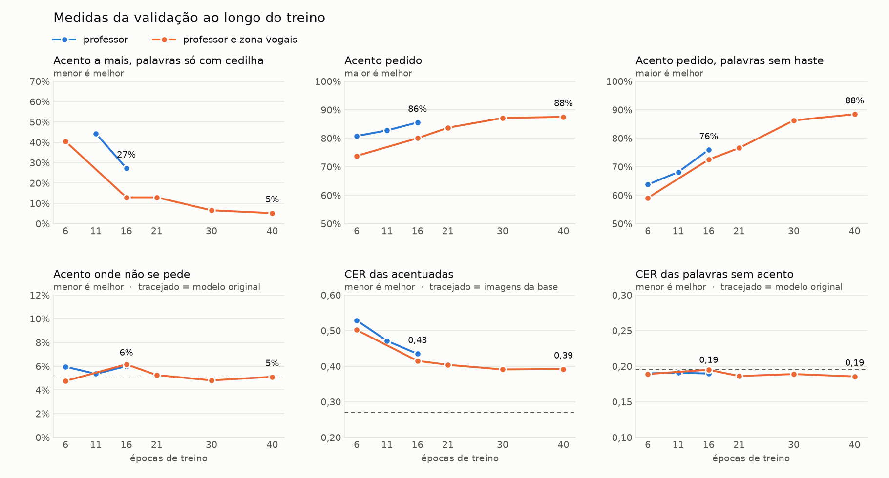

# 15 Acento a mais e variantes do professor

Continuação do [14](14_acento_separado_e_professor.md). O treino com acento
separado e professor resolveu o acento em palavra que não o pede e a letra das
palavras sem acento. Este documento trata do que sobrou, que está dentro da
palavra acentuada, e dos testes feitos contra isso. Todos os números são da
validação, pelo protocolo do [08](08_protocolo_de_avaliacao.md).

## Os dois problemas

Convém separar, porque as ideias testadas aqui melhoram um e pioram o outro.

| | problema 1 | problema 2 |
|---|---|---|
| o que é | acento em palavra que não pede acento | acento a mais em palavra que pede acento |
| exemplo | pedir "havera" e sair "hávera" | pedir "sofrerá" e sair "sófrerá" |
| situação no modelo com professor | 5 a 8%, no piso do detector | em aberto |

Junto com o problema 2 vem a letra das acentuadas, pior que a do esqueleto da
mesma palavra, e as palavras curtas acentuadas, que saem pequenas e tortas.

## Medidas usadas aqui

Além das do protocolo, duas contas feitas sobre o `paineis.tsv`.

Acento a mais nas palavras só com cedilha. Numa palavra cujo único sinal é a
cedilha, toda marca solta acima do corpo da palavra é acento a mais. São 11 das
30 palavras acentuadas, 440 imagens por modelo. Dispensa o alinhador, cuja
medida de posição concorda pouco com a anotação humana (kappa 0,29).

Uma correção nesta medida. Na primeira versão deste documento ela foi tirada
da coluna `marca` do `paineis.tsv`, que conta marca solta em cima ou embaixo
do corpo. Embaixo, numa palavra com ç, é quase sempre a própria cedilha solta
do c. A anotação humana do modelo de 40 épocas mostrou o erro: a coluna
acusou marca em 15 das 55 imagens de palavras só com cedilha, as pessoas viram
acento a mais em 1, e a marca só em cima acusou 4. Os números abaixo são da
marca só em cima, recalculados das imagens por
`diagnostico/marcas_so_cedilha.py` e guardados em
`diagnostico/resultados/acento_separado/marcas_so_cedilha.tsv`. Os modelos
cujas imagens não estão mais disponíveis (peso 5, controle e o professor com 6
épocas) ficam sem o número.

| palavras só com cedilha | coluna `marca`, em cima ou embaixo | só em cima, acento a mais | só embaixo |
|---|---|---|---|
| professor, 16 épocas | 45% | 27% | 24% |
| zona vogais, 16 épocas | 30% | 13% | 20% |
| zona vogais, 40 épocas | 22% | 5% | 18% |

A marca embaixo, a cedilha solta, fica perto de 20% em todos. A queda que se
via na medida antiga era quase toda acento a mais de verdade.

Marca nos sinais visíveis. A marca pedida nas outras 19 palavras, as que têm
agudo, til ou circunflexo. A "marca na acentuada" do protocolo mistura as duas
coisas, e nas palavras só com cedilha conta acento a mais como acerto.

| modelo, 16 épocas | marca nos sinais visíveis | acento a mais nas só com cedilha |
|---|---|---|
| acento separado, sem professor (controle) | 79% | sem as imagens |
| acento separado e professor | 86% | 27% |

Com a medida antiga o controle tinha 31% e o professor 45%, e daí se leu que o
professor piorava o acento a mais. Sem as imagens do controle essa comparação
não pôde ser refeita com a medida corrigida, e fica sem confirmação.

## Mais épocas ajudam

O [14](14_acento_separado_e_professor.md) registra que a marca na acentuada
cai de 81% para 71% entre 6 e 16 épocas. Separando as duas medidas, a leitura
se inverte.

| acento separado e professor | 6 épocas | 11 épocas | 16 épocas |
|---|---|---|---|
| marca nos sinais visíveis | 81% | 83% | 86% |
| acento a mais nas só com cedilha | | 44% | 27% |
| acento em palavra que não pede (esqueleto) | 6% | 5% | 5% |

O acento pedido sobe e o acento a mais cai. A queda de 81% para 71% era marca
solta sumindo das palavras com cedilha, parte acento a mais e parte cedilha que
passou a sair presa ao c. Nenhuma das duas medidas tinha parado de melhorar na
época 16.

## O acento separado é necessário

Treino só com o professor, sem `--acento_separado`, com o texto inteiro pelo
CANINE. Onze épocas, comparado com o professor com acento separado no mesmo
ponto.

| 11 épocas | com acento separado | só professor | diferença, IC95 |
|---|---|---|---|
| marca no esqueleto | 5% | 20% | +14 pp, de +10 a +20 |
| marca sem acento | 6% | 21% | +16 pp, de +9 a +23 |
| diferença pareada | +69 | +44 | −25 pp, de −36 a −14 |
| marca nos sinais visíveis | 83% | 56% | |
| acento a mais nas só com cedilha | 44% | 63% | |
| CER sem acento pedido, só sem marca | 0,186 | 0,194 | +0,013, de 0,000 a +0,027 |

Com o controle do [14](14_acento_separado_e_professor.md) isso fecha a tabela
das duas peças.

| | sem professor | com professor |
|---|---|---|
| texto pelo CANINE | problema 1 em 32%, letra ruim | problema 1 em 20%, letra boa |
| acento separado | problema 1 em 11%, letra ruim | problema 1 em 5%, letra boa |

O professor protege a letra nos dois casos. O acento separado é o que deixa o
modelo distinguir um texto com acento de um sem. Nas folhas do professor
sozinho, a palavra acentuada e o esqueleto saem quase iguais em cada coluna,
com marca nas duas ou em nenhuma. Leitura nossa, não testada à parte. Com o
CANINE a diferença entre "haverá" e "havera" é espalhada por todas as posições
e própria de cada palavra, e não se transfere bem para palavras novas. Com o
vetor separado a diferença é a mesma em qualquer palavra.

## É sorteio, não estilo

`diagnostico/diag_sementes.py`. Mesma palavra, mesmo escritor, mesmas imagens
de referência, 20 sementes. Dois escritores, o que mais e o que menos punha
marca indevida no modelo peso 5.

| modelo com professor, de 20 sementes | escritor 537 | escritor 318 |
|---|---|---|
| "sultan", marca indevida | 7 | 7 |
| "sofrera", marca indevida | 2 | 1 |
| "cacadora", marca indevida | 0 | 0 |
| "sofrerá", com marca | 19 | 18 |

Os dois se comportam igual, e com o mesmo estilo o resultado muda de uma
semente para outra. Em "sofrerá" o acento do fim sai quase sempre, e o que
varia é um acento a mais no "o" ou no "e". O acento a mais só aparece quando a
palavra pede algum acento. "cacadora" não teve marca em 40 gerações.

No modelo peso 5 o estilo pesava mais. A marca indevida ia de 13% no melhor
escritor a 37% no pior, com os mesmos escritores no topo nos quatro
checkpoints. Mesmo lá nenhum estilo ficava livre.

"sultan" é uma palavra ruim para o detector. Já dá marca em 5 de 40 no modelo
original, e nas folhas várias marcas são o corte do t ou um pedaço do l.

São 2 escritores, 3 palavras e 20 sementes. Dá para dizer que o estilo não é a
causa, não que o efeito dele é zero.

## Professor fora da máscara

`--professor_fora_mascara`. As amostras acentuadas também passam pelo
professor, com o texto sem acento. Dentro da máscara do acento o alvo continua
sendo o ruído sorteado. Fora dela é a previsão do professor.

| 16 épocas | professor | fora da máscara |
|---|---|---|
| marca nos sinais visíveis | 86% | 64% |
| acento a mais nas só com cedilha | 27% | 13% |
| marca no esqueleto, sem acento | 5%, 8% | 6%, 6% |
| diferença pareada | +66 | +50 |
| CER das acentuadas | 0,43 | 0,28 |
| o mesmo, só nas imagens sem marca | 0,37 | 0,23 |
| CER sem acento pedido | 0,190 | 0,187 |

A letra das acentuadas melhora bastante, e a melhora aparece também nas
imagens sem marca. O acento pedido cai, e o acento a mais cai pela metade.

A perda do acento se concentra nas palavras sem haste alta.

| palavras com agudo, til ou circunflexo | queda média da marca |
|---|---|
| sem haste ("pás", "pôr", "pensámos", "opressão", "conexões", "percussão" e mais uma) | 44 pp |
| com haste ("sofrerá", "haverá", "estarás", "matarás", "bálsamo", "reclusão", "confusões", "terráquea", "léguas", "relâmpagos") | 7 pp |

Nas folhas, a cedilha também enfraquece. Em "terço" some em quase todas as
imagens. É contagem de olho em 40 imagens.

No treino o erro dentro da máscara cai mais devagar, 0,095 na época 5 contra
0,075 no professor simples.

### A geometria da base

Para o sinal caber, a imagem acentuada da base ganha espaço no topo, e ao ser
reduzida a 64 px a palavra fica menor. Medido em 300 imagens de cada tipo.

| palavras de até 4 letras | altura da imagem | fração da altura ocupada pelo corpo |
|---|---|---|
| sem acento | 128 | 96% |
| par | 154 | 76% |
| acentuada, contando o sinal | 153 | 92% |

Nas palavras de 7 letras ou mais a diferença é pequena, 82% contra 88%. O
modelo com professor escreve a palavra curta acentuada menor que o esqueleto
dela. O fora da máscara escreve as duas no tamanho do original, e não sobra
lugar para o sinal.

### Geração mista

`diagnostico/diag_geracao_mista.py`. Sem treinar, o modelo com professor nos K
primeiros dos 50 passos do DDIM e o fora da máscara no resto, com o mesmo ruído
e o mesmo estilo. Oito escritores.

| imagens com marca, de 8 | pás | pôr | pensámos | sofrerá |
|---|---|---|---|---|
| só professor | 6 | 4 | 8 | 8 |
| só fora da máscara | 1 | 0 | 1 | 6 |
| professor nos 10 primeiros | 2 | 0 | 3 | 6 |
| professor nos 20 primeiros | 3 | 2 | 5 | 7 |
| professor nos 30 primeiros | 5 | 3 | 8 | 8 |
| fora nos 20 primeiros, depois professor | 1 | 3 | 8 | 8 |

Com K de 5 ou 10 as imagens são as do fora da máscara. A mudança acontece
entre os passos 20 e 30. Tamanho da palavra e acento se decidem na mesma
faixa, no meio da geração, e não nos primeiros passos como supúnhamos. Onde o
acento volta nas palavras curtas a imagem sai apagada e borrada, então misturar
os dois modelos na geração não serve de solução.

## Pares sem professor

`--professor_sem_pares`. Os pares da base, a acentuada sem o sinal, saem do
professor e voltam ao ruído sorteado. O professor segue nas geradas sem acento
e nas palavras reais do IAM, 69% das amostras em vez de 85%.

A hipótese. A acentuada e o par são a mesma imagem pequena. Com ruído alto a
imagem não mostra o tamanho, e o professor responde pelo texto, com a palavra
grande que ele escreveria. A acentuada aprende com a imagem pequena e o par com
o professor. A única entrada que distingue as duas é o vetor do sinal, que
passa a carregar também a mudança da palavra inteira. Com isso ele age como um
interruptor de "palavra acentuada" e não como um comando preso a uma letra.

| 16 épocas | controle | professor | pares sem professor |
|---|---|---|---|
| acento a mais nas só com cedilha | sem as imagens | 27% | 10% |
| CER das acentuadas | 0,39 | 0,43 | 0,37 |
| marca nos sinais visíveis | 79% | 86% | 79% |
| sem haste | 61% | 76% | 59% |
| com haste | 92% | 93% | 93% |
| marca no esqueleto | 11% | 5% | 9% |
| CER sem acento pedido | 0,281 | 0,190 | 0,248 |
| diferença pareada | +51 | +66 | +53 |

Com 6 épocas o protocolo dava 72% de marca na acentuada, 16% no esqueleto, 7%
sem acento e +55, com acento a mais nas só com cedilha em 40%. O mesmo
movimento do professor, o acento a mais caindo com as épocas.

Bootstrap por palavra, pares sem professor menos professor. Marca no esqueleto
+4 pp, de +2 a +7. CER sem acento pedido +0,059, de +0,045 a +0,073. Diferença
pareada −13 pp, de −18 a −7.

O mecanismo se confirma. O acento a mais cai de 27% para 10%, e nas folhas a palavra curta
acentuada passa a sair do mesmo tamanho do esqueleto. O custo é maior que o
ganho. A letra das palavras sem acento piora, o problema 1 sobe e o acento
pedido cai nas palavras sem haste. Na maioria das medidas o modelo fica perto
do controle. Os pares são 15% do treino, e é neles que o professor faz a maior
parte do efeito.

Nas folhas aparece cedilha no esqueleto de palavras como "cacadora", o que o
detector não mede.

## O que os testes dizem juntos

- O professor nos pares causa o acento a mais e é também o que segura a letra
  e o problema 1. Tirar um leva o outro.
- Limpar a letra das acentuadas com o alvo do professor tira o lugar do sinal
  nas palavras sem haste. A única configuração em que o modelo aprendeu a
  desenhar acento nessas palavras é a palavra encolhida, que o professor não
  produz.
- O melhor modelo é o acento separado com professor e zona vogais, com 40
  épocas. Ver a seção do viés do peso.

## O viés do peso e a zona vogais

O peso 5 vale só onde o sinal está naquela amostra. Com um peso w que depende
da amostra, a previsão que minimiza o erro numa célula deixa de ser a média do
alvo e passa a ser a média ponderada, E[w·y] / E[w]. Numa célula em que há
sinal com probabilidade p, isso dá 5p / (5p + 1 − p) da intensidade do sinal.

| chance real de haver sinal | intensidade prevista com peso 5 |
|---|---|
| 10% | 36% |
| 20% | 56% |

Ou seja, deixar de desenhar um sinal custa 5 e desenhar um a mais custa 1. Nas
palavras sem acento a chance é perto de zero e não há o que inflar, o que
combina com o acento a mais só aparecer nas palavras que pedem acento.

O conserto é pôr o mesmo peso nos lugares onde um sinal poderia estar. Isso já
existe no código, é a zona vogais da fase 9 do
[07](07_experimentos_com_acentos.md), com `--peso_zona 5 --zona vogais`. Lá o
ganho foi pequeno, mas o modelo não lia o pedido de acento e a letra vinha
estragada por outra causa. Não foi testada com acento separado e professor.

A máscara para a base atual está em `iam_pt_alinhado/zona_vogais.npz`, gerada
por `scripts/mascaras_vogais.py` (11 minutos de CPU).

### Resultado

Treino com professor e acento separado, mais `--peso_zona 5 --zona vogais`.
Dezesseis épocas no Colab, numa T4, em três sessões com retomada. Os testes de
`diagnostico/` passaram na placa, e a primeira época repetiu os números do
treino com professor na máquina local.

| 16 épocas | professor | professor e zona vogais | diferença, IC95 |
|---|---|---|---|
| acento a mais nas só com cedilha | 27% | 13% | |
| marca nos sinais visíveis | 86% | 80% | |
| sem haste | 76% | 72% | |
| com haste | 93% | 85% | |
| marca no esqueleto | 5% | 6% | +1 pp, de −1 a +3 |
| marca sem acento | 8% | 6% | −1 pp, de −3 a 0 |
| CER sem acento pedido | 0,190 | 0,195 | +0,005, de −0,002 a +0,012 |
| CER das acentuadas | 0,43 | 0,41 | |

Com 6 épocas o acento a mais nas só com cedilha era 41%. Do professor com 6
épocas não há mais as imagens.

É a primeira variante que reduz o acento a mais sem trazer de volta o problema
1 nem estragar a letra. O acento a mais cai pela metade, de 27% para 13%. O
custo são 6 pontos de marca nos sinais visíveis.

Parte desse custo não é perda. Nas folhas de "relâmpagos" o professor põe a
marca sobre o "a" errado na maioria das colunas, e a zona vogais tira essas
marcas sem pôr a certa. O detector contava a marca errada como presença. Em
"caçadora" a cedilha continua nas seis colunas e os agudos e tils sobrando
somem. Em "sofrerá" o acento do fim fica e o acento a mais diminui, sem sumir.
São três palavras olhadas, e a posição segue sem medida confiável.

### Treino mais longo

O mesmo treino continuado de 16 para 30 e depois 40 épocas, na RX 9060 XT, a
partir do estado salvo no Colab.

| professor e zona vogais | 6 épocas | 16 épocas | 21 épocas | 30 épocas | 40 épocas | professor, 16 épocas |
|---|---|---|---|---|---|---|
| acento a mais nas só com cedilha | 41% | 13% | 13% | 7% | 5% | 27% |
| marca nos sinais visíveis | 74% | 80% | 84% | 87% | 88% | 86% |
| sem haste | 59% | 72% | 77% | 86% | 88% | 76% |
| com haste | 85% | 85% | 89% | 88% | 87% | 93% |
| circunflexo, duas palavras | 59% | 56% | 61% | 79% | 75% | 71% |
| marca no esqueleto | 5% | 6% | 5% | 5% | 4% | 5% |
| marca sem acento | 5% | 6% | 5% | 5% | 6% | 8% |
| CER sem acento pedido | | 0,195 | | 0,189 | 0,186 | 0,190 |
| CER das acentuadas | 0,50 | 0,41 | 0,40 | 0,39 | 0,39 | 0,43 |

Com 30 épocas a zona vogais recupera a marca pedida que tinha custado, passa o
professor nas palavras sem haste e fica com um quarto do acento a mais dele. O problema 1 e a letra das palavras sem acento não se mexem, e a
letra das acentuadas melhora devagar. Nada piorou com o treino mais longo.
Entre 16 e 30 épocas nenhuma diferença isolada do protocolo tem intervalo
longe do zero, mas todas vão na mesma direção.

Nas folhas, com 30 épocas "pôr" sai com o sinal sobre o "o" nas seis colunas,
e "relâmpagos" passa a ter o sinal sobre o primeiro "a" em quatro delas, onde
antes ele caía sobre o segundo.

Entre 30 e 40 épocas o treino estaciona. O acento pedido e o CER das
acentuadas não se mexem, e só o acento a mais ainda cai, de 7% para 5%.
Nenhuma medida piora. O modelo de 40 épocas é o melhor até aqui, por pouco
sobre o de 30.



A figura é de `diagnostico/grafico_epocas.py`, que lê os `paineis.tsv`
guardados e o `marcas_so_cedilha.tsv`, e calcula as duas medidas desta
página. As curvas achatam a partir de 30 épocas. O acento a mais nas palavras
só com cedilha chega a 5%, e as pessoas viram 2% na anotação. O CER das
acentuadas fica longe da referência, 0,27. As duas medidas que não podem piorar ficam coladas
no modelo original do começo ao fim. São cinco pontos de um treino só, e o
ponto de 21 épocas mostra uma oscilação de uns 3 pontos entre avaliações.

A diferença pareada do protocolo cai de +66 para +56 com 16 épocas e fica em
+59 com 30. Ela soma como acerto qualquer marca solta das palavras só com
cedilha, acento a mais ou cedilha solta, então a queda mistura o ganho com o
custo e não serve para julgar esta variante.

## Professor fora da máscara só em ruído baixo

`--professor_fora_mascara --professor_fora_t_max 400`, sobre a zona vogais. O
professor só vale fora da máscara nas amostras acentuadas com ruído abaixo de
t = 400, os últimos 20 dos 50 passos da geração. Acima disso a acentuada fica
com o ruído sorteado. A aposta era limpar a letra das acentuadas sem tirar o
lugar do sinal, já que tamanho e acento se decidem antes. Dezesseis épocas no
Colab, numa sessão só.

| 16 épocas | zona vogais | com fora da máscara em ruído baixo | fora da máscara em todo ruído, sem zona |
|---|---|---|---|
| CER das acentuadas | 0,41 | 0,31 | 0,28 |
| o mesmo, só sinais visíveis e com marca | 0,44 | 0,37 | 0,34 |
| marca nos sinais visíveis | 80% | 69% | 64% |
| sem haste | 72% | 45% | 34% |
| com haste | 85% | 87% | 86% |
| acento a mais nas só com cedilha | 13% | 9% | 13% |
| marca no esqueleto, sem acento | 6%, 6% | 5%, 5% | 6%, 6% |
| CER sem acento pedido | 0,195 | 0,191 | 0,187 |

A letra das acentuadas melhora bastante, e a melhora aparece também nas
imagens que têm a marca. O acento das palavras sem haste volta a cair, de 72%
para 45%. O acento a mais cai um pouco, de 13% para 9%. Restringir ao ruído
baixo atenuou o defeito do fora da máscara original, sem tirá-lo.

Nas folhas, "pôr" sai grande, limpa e sem sinal, com a mesma forma do
esqueleto. Em "bálsamo" a letra fica mais limpa e o acento se mantém em parte
das colunas. Ou seja, mesmo cobrando o professor só no fim da geração, a
palavra acentuada passa a ter a geometria do esqueleto desde o começo. A
suposição de que o que se treina em ruído baixo não mexe no que o modelo faz
em ruído alto não se sustentou.

As três tentativas de aproximar a acentuada do esqueleto dão a mesma troca,
em doses diferentes. Quanto mais a palavra acentuada é cobrada a se parecer
com o que o modelo original escreveria, mais limpa a letra e menos acento nas
palavras sem haste. A zona vogais sem o fora da máscara segue sendo o melhor
modelo.

## Próximos passos

| treino | o que muda em relação ao professor | situação |
|---|---|---|
| mais épocas da zona vogais | | feito até 40, o treino estacionou |

Ideias guardadas, na ordem em que as tentaríamos.

- Reforço por posição na geração, sem treino. Somar à previsão a diferença
  entre ela e a média das previsões com o sinal em cada outra vogal.
- Professor fora da máscara só com ruído baixo, abaixo do passo em que tamanho
  e acento se decidem.
- Acentos em posições que o português não usa, na base, para a posição do
  vetor deixar de ser previsível pelo esqueleto. Mexe no vocabulário
  congelado.
- Perda na atenção cruzada que prende a posição do sinal às colunas da letra.

## O que a anotação humana mostrou

Duas pessoas anotaram 212 imagens do modelo de 40 épocas, sem saber o que foi
pedido, e uma terceira desempatou. O registro completo está em
`avaliacao_diacriticos/anotacao_40ep.md`. Concordância entre as duas pessoas,
kappa 0,64 para a classe do acento nas palavras com sinal em cima e 62 de 63
para a cedilha.

| no modelo de 40 épocas, pelo gabarito humano | |
|---|---|
| acento pedido presente, palavras com sinal em cima | 71 de 80 (89%) |
| acento a mais nessas palavras | 12 de 80 (15%) |
| acento a mais nas palavras só com cedilha | 1 de 55 |
| cedilha pedida desenhada | 62 de 63 |
| cedilha onde não se pediu | 0 de 117 |
| qualquer marca em palavra que não pede acento | 0 de 45 |
| legível, pela pessoa | 142 de 180 (79%) |

Contra o gabarito, a tinta abaixo do c mede a cedilha com kappa 0,91 e o
detector de marcas acerta "há marca em cima" com kappa 0,79. O acento a mais
por posição, pelo alinhador, continua fraco, com precisão de 38%.

O problema 1 está resolvido também no olho humano. O acento a mais que sobra
está nas palavras com acento em cima.

## Estado atual e como continuar

Onde estão as coisas.

| o quê | onde |
|---|---|
| melhor modelo, zona vogais com 40 épocas | máquina com GPU, usuário `leozao`, `~/htg-diag/model_zona_vogais/models/ema_ckpt.pt` |
| o mesmo treino com 16 e com 30 épocas | na mesma pasta, `ema_16ep.pt` e `ema_30ep.pt` |
| estado para continuar esse treino | na mesma pasta, `ckpt.pt`, `optim.pt` e `estado.pt` |
| professor com 16 épocas | `~/htg-diag/model_iam_pt_separado_professor/models/ema_ep15.pt` |
| imagens de cada avaliação | pastas `avaliacao_*_val` em `~/htg-diag`, fora do git |
| tabelas, configurações, logs e figuras | `diagnostico/resultados/acento_separado/`, no git |

Para um treino novo, mudando uma coisa em relação ao melhor.

```bash
NOME=meu_teste EPOCAS=16 PONTOS="6 16" \
    ARGS="--acento_separado --peso_zona 5 --zona vogais <a mudança>" bash scripts/treino_completo.sh
```

Depois, guardar o resumo e o `paineis.tsv` da avaliação numa pasta de
`diagnostico/resultados/acento_separado/`, acrescentar a linha em `TREINOS` no
`diagnostico/grafico_epocas.py` e rodar. Ele imprime as medidas desta página
para cada ponto. As figuras lado a lado saem de `scripts/comparar_paineis.py`
e o bootstrap de `scripts/comparar_avaliacoes.py`, como no
[14](14_acento_separado_e_professor.md).

O que está em aberto, por ordem de quanto falta.

- Mais épocas não resolvem o que falta. O treino estacionou em 40.
- Letra das palavras acentuadas, CER 0,39 contra 0,27 nas imagens da base. As
  variantes do professor fora da máscara limpam a letra e tiram o acento das
  palavras sem haste. Falta uma ideia que não dependa de aproximar a acentuada
  do esqueleto, ou uma base em que a palavra acentuada não precise encolher.
- Acento a mais nas palavras com acento em cima, 15% pelo gabarito humano.
  Nas palavras só com cedilha ele quase sumiu.
- A posição do acento ainda não tem medida automática confiável. A cedilha
  passou a ter, a tinta abaixo do c, validada pela anotação.
- Os documentos 07, 09 e 10 e o resumo do `README.md` desta pasta ainda
  descrevem o estado anterior ao acento separado.

## Treinar fora da máquina local

`nuvem/treino_colab.ipynb` roda o mesmo treino numa GPU do Colab.

- `scripts/pacote_nuvem.sh` monta `pacote_nuvem.tar`, 2,8 GB, com o que não
  está no git. Vai para uma pasta privada do Google Drive.
- `scripts/treino_completo.sh` treina ou continua, avalia e empacota o
  resultado, com envio por scp. É o que se usa na máquina com GPU.
- `scripts/treino_nuvem.sh` tem os valores fixos do treino com professor e
  recebe em `ARGS` só o que muda. Copia o estado para uma pasta durável ao fim
  de cada época e retoma dali numa sessão nova. Serve também na máquina local.

```bash
NOME=zona_vogais EPOCAS=16 DESTINO=./copias \
    ARGS="--acento_separado --peso_zona 5 --zona vogais" bash scripts/treino_nuvem.sh
```

Um treino de 16 épocas rodou no Colab gratuito, a 20 minutos por época numa
T4, o dobro da RX 9060 XT. A cópia ocupa 2,3 GB no Drive. Cada arquivo
sobrescrito vai para a lixeira do Drive e continua contando no espaço, então
num treino longo é preciso esvaziá-la de tempos em tempos.

## Registros

Em `diagnostico/resultados/acento_separado/`, uma pasta por avaliação com o
resumo e o `paineis.tsv`.

| pasta | modelos |
|---|---|
| `avaliacao_controle_val` | controle, 6 e 16 épocas |
| `avaliacao_fora_val` | professor fora da máscara, 6 e 16 épocas |
| `avaliacao_so_prof_val` | só professor e professor com acento separado, 11 épocas |
| `avaliacao_sem_pares_val` | pares sem professor, 6 e 16 épocas, avaliados na CPU |
| `avaliacao_zona_vogais_val` | professor e zona vogais, 6 e 16 épocas, treinado e avaliado no Colab |
| `avaliacao_zona_vogais_30ep_val` | o mesmo treino continuado, 21 e 30 épocas |
| `avaliacao_zona_vogais_40ep_val` | o mesmo treino, 40 épocas |
| `avaliacao_zona_fora_baixo_val` | zona vogais com professor fora da máscara em ruído baixo, 6 e 16 épocas |

As pastas `comparacao_*` têm quatro figuras de cada comparação.
`diagnostico/resultados/sementes/` e `diagnostico/resultados/geracao_mista/`
têm as tabelas e duas folhas de cada teste.

## Trabalhos relacionados

Lidos por nós.

- Masip, Rodríguez, Tuytelaars e van de Ven, Continual Learning of Diffusion
  Models with Generative Distillation, CoLLAs 2024, arXiv 2311.14028. Base do
  professor, ver o [14](14_acento_separado_e_professor.md).
- Ahitoliev e Berezin, Diffusion-Based Ukrainian Handwritten Text Generation
  with Cross-Domain Style Transfer, arXiv 2605.27487.

Apontados em consultas a modelos de linguagem. Conferimos na página do arXiv
que existem e que o resumo diz o que está escrito aqui. Ainda não foram lidos
por inteiro.

- Li e Hoiem, Learning without Forgetting, ECCV 2016, arXiv 1606.09282.
  Acrescentar uma tarefa a uma rede usando só os dados novos, mantendo as
  respostas antigas como alvo.
- Chefer, Alaluf, Vinker, Wolf e Cohen-Or, Attend-and-Excite, SIGGRAPH 2023,
  arXiv 2301.13826. O Stable Diffusion omite sujeitos do texto ou liga
  atributos ao objeto errado. Corrige na geração, pela atenção cruzada.
- Rassin, Hirsch, Glickman, Ravfogel, Goldberg e Chechik, Linguistic Binding
  in Diffusion Models, NeurIPS 2023, arXiv 2306.08877. Uma perda na geração faz
  o mapa de atenção de cada modificador coincidir com o da sua entidade e se
  afastar das outras. O sinal seria o modificador e a letra a entidade.
- Wang, Sha, Ding, Wang e Tu, TokenCompose, CVPR 2024, arXiv 2312.03626.
  Fine-tune com perdas que alinham cada token do texto à região do seu objeto.
  Precedente de supervisão da atenção no treino.
- Avrahami, Aberman, Fried, Cohen-Or e Lischinski, Break-A-Scene, SIGGRAPH
  Asia 2023, arXiv 2305.16311. Um token novo por conceito, com perda de difusão
  mascarada e perda na atenção cruzada para os conceitos não se misturarem. É
  o caso mais parecido com o do vetor de sinal.
- Wang, Zhang, Xu e Jin, DreamText, arXiv 2405.14701. Texto renderizado em
  imagens, com orientação por caractere no treino. Aponta repetição e falta de
  caracteres como falhas, o análogo do acento a mais.

Citados nas mesmas consultas e não conferidos por nós. Prompt-to-Prompt (Hertz
e outros), GLIGEN (Li e outros), Ablating Concepts (Kumari e outros), Attention
Refocusing (Phung e outros), A-STAR (Agarwal e outros), TextDiffuser (Chen e
outros), UDiffText (Zhao e Lian), FastComposer (Xiao e outros), Bounded
Attention (Dahary e outros).
