# Resultados

O caminho do trabalho em uma página, da primeira tentativa ao modelo atual,
com os números principais e uma figura de cada fase. Os detalhes de cada passo
estão nos documentos de `docs/`, citados em cada seção.

Todos os números de modelo são da validação, pelo protocolo de
`scripts/avaliar_pt.py` ([docs/08](../docs/08_protocolo_de_avaliacao.md)),
salvo onde dito. O split de teste nunca foi aberto.

| fase | pergunta | resposta |
|---|---|---|
| 1. Sonda | o DiffusionPen original escreve acento? | não, omite ou deforma |
| 2. BRESSAY | treinar em escrita real em português resolve? | não, piorou tudo |
| 3. Acentos sintéticos | e desenhar o acento nas imagens de treino? | o acento aparece, mas também onde não deve, e a letra piora |
| 4. Peso no acento | cobrar mais o erro na região do acento? | mais acento, mais acento indevido |
| 5. Acento separado e professor | separar letra e sinal na entrada e ancorar no modelo original? | acento indevido e letra voltam ao nível do original |
| 6. Zona vogais e treino longo | equilibrar o custo de errar para mais e para menos? | o melhor modelo, acento pedido em 88% e acento a mais em 5% |
| 7. Validação humana | o que medimos bate com o que uma pessoa vê? | sim para presença e cedilha, não para posição |

## 1. Sonda: o modelo original não sabe desenhar acento

O DiffusionPen público, treinado no IAM (inglês), recebe o texto com acento,
mas não desenha o sinal. Em "mão", "ação", "você" ou "força" o acento some ou
a palavra deforma. Detalhes em [docs/04](../docs/04_sonda_e_metrica_inicial.md).

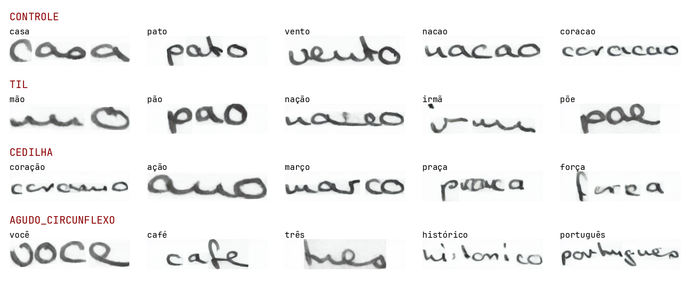

## 2. BRESSAY: escrita real em português não resolveu

O primeiro fine-tune usou o BRESSAY, base de escrita manuscrita em português.
A letra piorou em tudo e nenhum acento foi aprendido. As palavras do BRESSAY
têm cerca de 26 px de altura, e nesse tamanho o acento ocupa 1 ou 2 px. Ver
[docs/05](../docs/05_finetune_bressay.md).

Na figura, o modelo original à esquerda e os dois fine-tunes no BRESSAY.

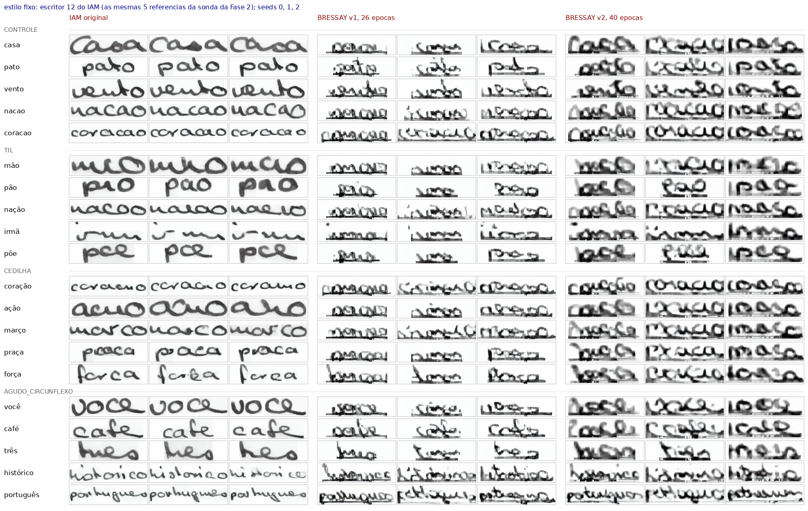

## 3. Acentos sintéticos: o acento aparece

A saída foi criar dados. Palavras em português são geradas pelo próprio
DiffusionPen e um script desenha o acento sobre a letra certa, localizada por
um alinhador. Cada palavra acentuada tem um par, a mesma imagem sem o sinal.
Ver [docs/06](../docs/06_acentos_sinteticos.md).

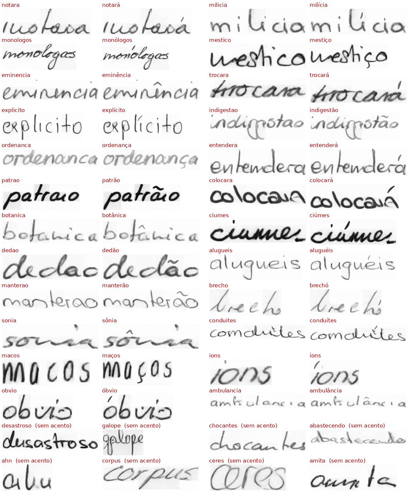

Com essa base o modelo passa a desenhar acento a partir do texto, o que o
original não faz. Mas também põe acento onde não se pede, e a letra fica pior.
Os controles mostraram que a piora vem dos dados sintéticos e não do fine-tune
em si. Ver [docs/07](../docs/07_experimentos_com_acentos.md).

## 4. Peso no acento

O acento ocupa 2% da imagem no espaço latente. Cobrar 5 vezes mais o erro
nessa região aumentou o acento pedido e também o indevido.

| modelo, 16 épocas | marca na acentuada | marca no esqueleto | marca sem acento | diferença pareada | CER sem acento |
|---|---|---|---|---|---|
| IAM original | 6% | 5% | 5% | +1 | 0,22 |
| controle, sem peso | 46% | 30% | 25% | +16 | 0,32 |
| peso 5 | 57% | 34% | 32% | +23 | 0,32 |

O controle e o peso 5 são o mesmo treino na base sintética, e diferem só no
peso. Por isso a diferença entre eles, +7 pontos na diferença pareada (IC95 de
+3 a +11), é atribuída ao peso. O CER desta tabela é o das 20 palavras sem
acento.

O esqueleto é a mesma palavra pedida sem o acento. A diferença pareada é a
marca na acentuada menos a marca no esqueleto, com o mesmo escritor e a mesma
semente, e mede quanto do acento vem do texto.

Na figura, "haverá" e "havera" no modelo original, no controle sem peso e no
peso 5. Barra verde é marca detectada na acentuada e vermelha no esqueleto.

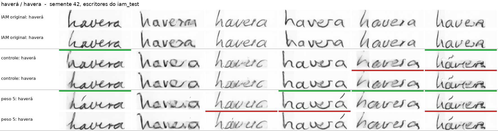

Tentativas seguintes, como penalizar o acento nas regiões vazias ou voltar a
palavras reais do IAM, reduziram pouco o acento indevido e não trouxeram a
letra de volta.

## 5. Acento separado e professor

Uma investigação com testes pequenos na CPU ([docs/13](../docs/13_investigacao_do_vazamento_e_da_letra.md))
levou a duas mudanças no treino ([docs/14](../docs/14_acento_separado_e_professor.md)).

- Acento separado. O codificador de texto lê a palavra sem acento, e o sinal
  entra por um vetor próprio, somado só na posição da letra. A parte das letras
  fica igual à que o modelo original conhece.
- Professor. Uma cópia congelada do modelo original. Nas palavras sem acento,
  o modelo novo aprende a responder como ele, o que protege a letra.

| modelo, 16 épocas | marca na acentuada | marca no esqueleto | marca sem acento | diferença pareada | CER sem acento pedido |
|---|---|---|---|---|---|
| IAM original | 6% | 5% | 5% | +1 | 0,195 |
| peso 5 | 57% | 34% | 32% | +23 | 0,312 |
| acento separado | 61% | 11% | 11% | +51 | 0,281 |
| acento separado e professor | 71% | 5% | 8% | +66 | 0,190 |

As duas peças são necessárias, cada uma para uma coisa.

| | sem professor | com professor |
|---|---|---|
| texto inteiro pelo codificador | acento indevido em 32%, letra ruim | acento indevido em 20%, letra boa |
| acento separado | acento indevido em 11%, letra ruim | acento indevido em 5%, letra boa |

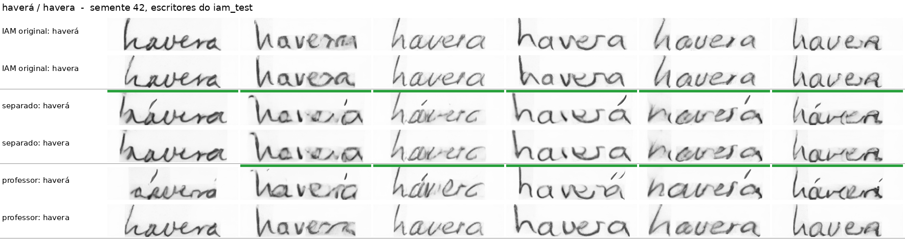

## 6. Zona vogais e treino longo: o modelo atual

Com o professor, o problema restante era o acento a mais dentro da palavra
acentuada, como "sófrerá" no lugar de "sofrerá". O peso 5 só valia onde o
acento estava, então errar para menos custava 5 e errar para mais custava 1. A
zona vogais põe o mesmo peso em cima de toda vogal e embaixo de todo c. Ver
[docs/15](../docs/15_acento_a_mais_e_variantes_do_professor.md).

| | professor, 16 épocas | zona vogais, 40 épocas |
|---|---|---|
| acento pedido, palavras com agudo, til ou circunflexo | 86% | 88% |
| o mesmo, palavras sem haste alta | 76% | 88% |
| acento a mais, palavras só com cedilha | 27% | 5% |
| marca em palavra que não pede acento | 5% e 8% | 4% e 6% |
| CER das palavras sem acento pedido | 0,190 | 0,186 |
| CER das palavras acentuadas | 0,43 | 0,39 |

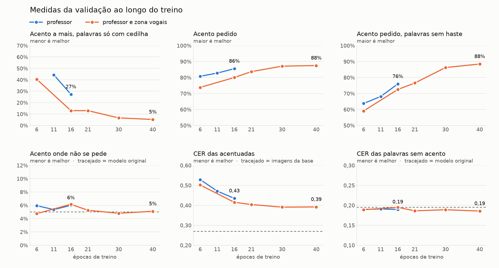

O treino melhora até 30 épocas e estaciona em 40. A letra das palavras sem
acento fica no nível do modelo original o tempo todo.

Nas figuras, o professor de 16 épocas em cima e a zona vogais de 40 embaixo.
Em "caçadora" os acentos sobrando somem e a cedilha fica. Em "pôr" o sinal
passa a cair sobre o "o". Em "relâmpagos" ele sai do segundo "a" para o
primeiro.

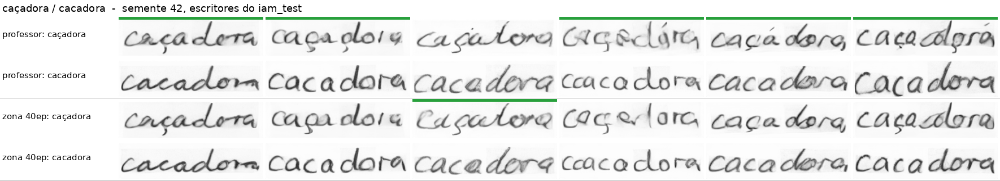
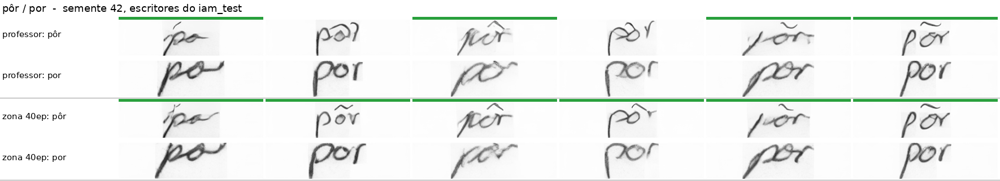
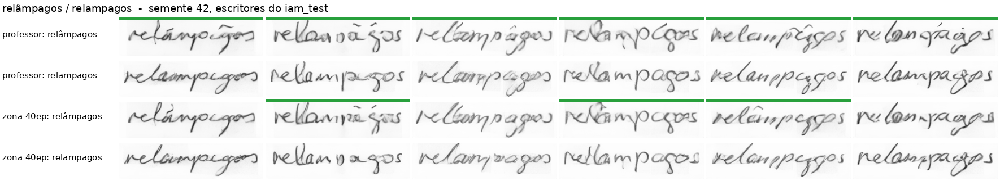

Três variantes para limpar a letra das palavras acentuadas foram testadas e
descartadas. Todas limparam a letra e tiraram o acento das palavras sem haste
alta, como "pôr" e "pás". Na base, a palavra acentuada é sempre menor que a
normal, para o sinal caber em cima, e as variantes cobravam do modelo a
palavra no tamanho normal.

## 7. Validação humana e métrica

Duas pessoas anotaram 212 imagens do modelo de 40 épocas sem saber o que tinha
sido pedido, e uma terceira desempatou. Ver
[avaliacao_diacriticos/anotacao_40ep.md](../avaliacao_diacriticos/anotacao_40ep.md).

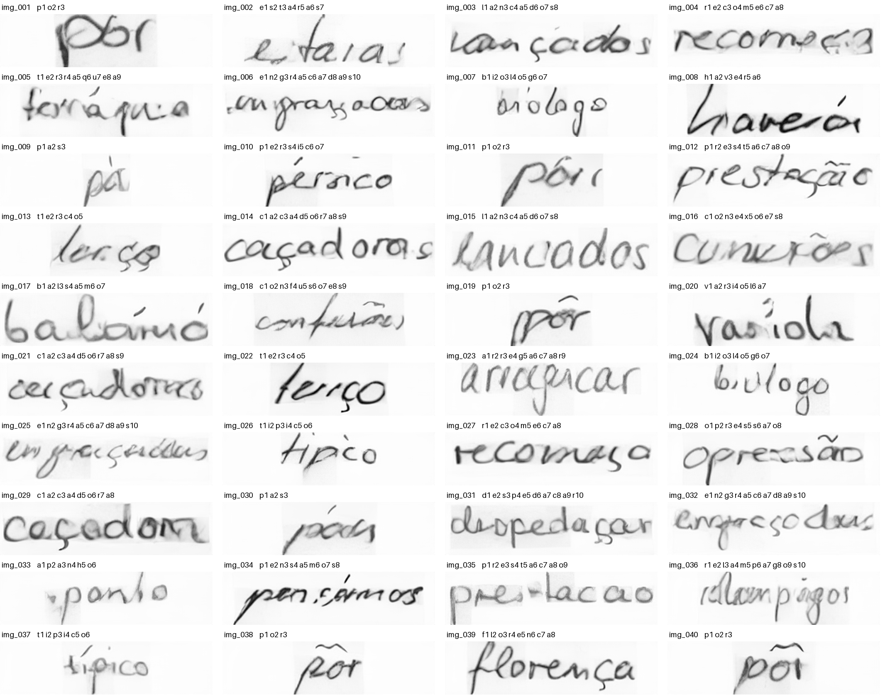

As duas pessoas concordam bem sobre acento (kappa 0,64) e cedilha (62 de 63
imagens), e pouco sobre legibilidade.

O que elas viram no modelo de 40 épocas.

| | gabarito humano |
|---|---|
| acento pedido presente, palavras com sinal em cima | 71 de 80 |
| acento a mais nessas palavras | 12 de 80 |
| cedilha pedida desenhada | 62 de 63 |
| cedilha onde não se pediu | 0 de 117 |
| qualquer marca em palavra que não pede acento | 0 de 45 |
| legível | 142 de 180 |

Como as medidas automáticas se saem contra esse gabarito.

| pergunta | medida | kappa |
|---|---|---|
| há marca em cima | detector de marcas soltas | 0,79 |
| há cedilha | tinta abaixo do c, criada nesta etapa | 0,91 |
| há cedilha | detector de marcas soltas | 0,15 |
| o acento está na letra certa | detector com alinhador | fraca, precisão de 38% no acento a mais |

A cedilha, 40% dos sinais avaliados, passou a ser medida. Na figura, cedilhas
pedidas que a medida nova acerta, com a coluna do c em azul e o corte em
vermelho.

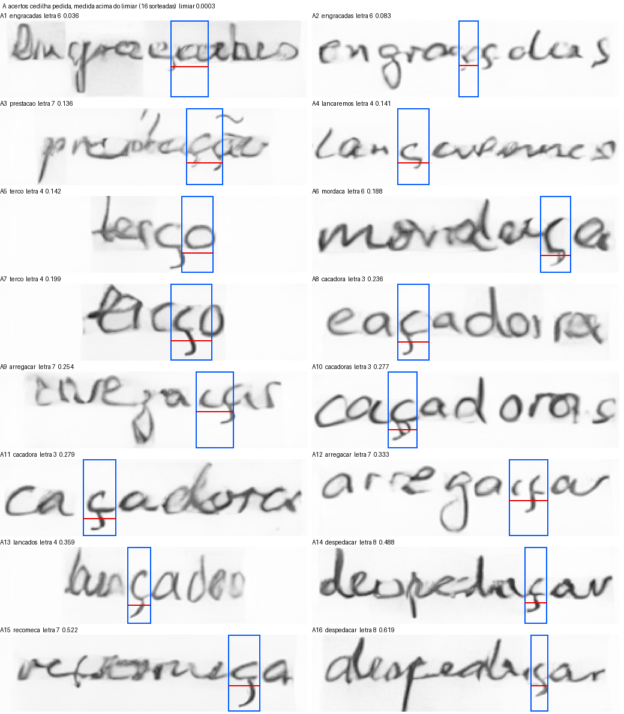

A anotação também corrigiu uma medida de treino. O acento a mais vinha sendo
contado com qualquer marca solta, e nas palavras com ç a marca embaixo é a
própria cedilha solta. Corrigido, o acento a mais caiu de 22% para 5% no
modelo de 40 épocas. A correção está no [docs/15](../docs/15_acento_a_mais_e_variantes_do_professor.md).

## O que falta

- Acento a mais nas palavras com acento em cima, 15% pelo gabarito humano.
- Letra das palavras acentuadas, CER 0,39 contra 0,27 nas imagens da própria
  base. As tentativas apontam para a base, onde a palavra acentuada encolhe.
- Medida automática da posição do acento.

## Limitações

- Palavras com "i" e "j" ficam fora da avaliação automática, porque o pingo
  confunde o detector. Elas entraram só na anotação humana.
- Uma rodada de treino por configuração, sem repetição com outra semente.
- A validação humana é de um modelo só.
