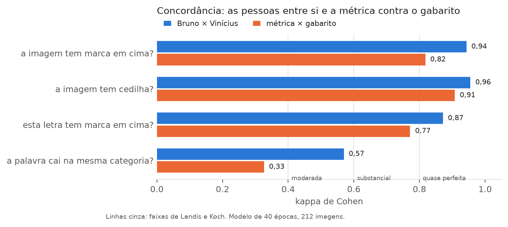
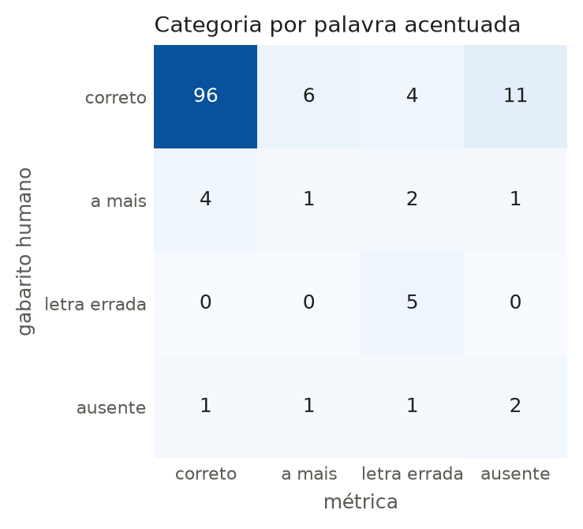
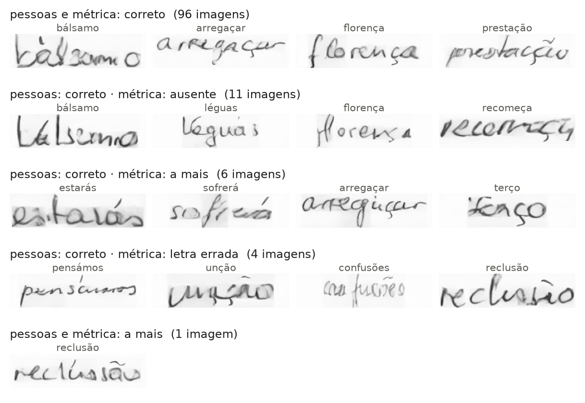

# A métrica em números

Quanto a métrica concorda com as pessoas, e o que ela mostra nos treinos.
Gerado por `python avaliacao_diacriticos/relatorio.py`; não edite à mão.
Uma linha por imagem anotada em [validacao.tsv](validacao.tsv).

Modelo final (zona vogais, 40 épocas), 212 imagens. Bruno e Vinícius anotaram
cada um sozinho; o gabarito é a resposta dos dois onde concordam e a decisão do
Leonardo onde discordam. Palavras com i ou j ficam fora das perguntas sobre
marca em cima (o pingo parece acento), por isso essas têm 180 imagens.

Kappa: concordância descontada do que viria por acaso; 1 é perfeita, 0 é acaso.
Precisão: dos "sim" da métrica, quantos o gabarito confirma. Recall: dos "sim"
do gabarito, quantos a métrica acha.

## 1. A métrica contra o gabarito

| pergunta | comparadas | mesma resposta | kappa | só o gabarito disse sim | só a métrica disse sim | precisão | recall |
|---|---|---|---|---|---|---|---|
| a imagem tem marca em cima? | 180 imagens | 164 (91%) | +0,82 | 9 | 7 | 0,91 | 0,88 |
| a imagem tem cedilha? | 212 imagens | 204 (96%) | +0,91 | 6 | 2 | 0,97 | 0,90 |
| esta letra tem marca em cima? | 1.358 letras | 1.322 (97%) | +0,77 | 19 | 17 | 0,80 | 0,78 |
| a palavra acentuada cai na mesma categoria? | 135 imagens | 104 (77%) | +0,33 | - | - | - | - |

## 2. Bruno contra Vinícius

Antes do desempate. É o teto: a métrica não tem como concordar com as pessoas mais do que elas entre si.

| pergunta | comparadas | mesma resposta | kappa | só Bruno disse sim | só Vinícius disse sim |
|---|---|---|---|---|---|
| a imagem tem marca em cima? | 180 imagens | 175 (97%) | +0,94 | 1 | 4 |
| a imagem tem cedilha? | 212 imagens | 208 (98%) | +0,96 | 2 | 2 |
| esta letra tem marca em cima? | 1.358 letras | 1.338 (99%) | +0,87 | 7 | 13 |
| a palavra acentuada cai na mesma categoria? | 135 imagens | 119 (88%) | +0,57 | - | - |

## 3. Categoria da palavra, métrica contra o gabarito

Palavras acentuadas sem i nem j. Linha: gabarito. Coluna: métrica.

| gabarito \ métrica | correto | a mais | letra errada | ausente | total |
|---|---|---|---|---|---|
| correto | 96 | 6 | 4 | 11 | 117 |
| a mais | 4 | 1 | 2 | 1 | 8 |
| letra errada | 0 | 0 | 5 | 0 | 5 |
| ausente | 1 | 1 | 1 | 2 | 5 |
| total | 101 | 8 | 12 | 14 | 135 |

O erro mais comum é o gabarito dizer correto e a métrica dizer ausente: o
sinal encosta na letra ou sai partido.

## 4. A métrica nos treinos

1.200 imagens de palavras acentuadas por modelo, no protocolo de validação.

| modelo | correto | a mais | letra errada | ausente | palavra degradada (E2) |
|---|---|---|---|---|---|
| só professor, 11 ép. | 14% | 23% | 16% | 46% | 50% |
| professor, 16 ép. | 44% | 26% | 16% | 13% | 46% |
| pares sem professor, 16 ép. | 47% | 18% | 15% | 20% | 19% |
| fora da máscara, 16 ép. | 39% | 11% | 14% | 36% | 15% |
| fora em ruído baixo, 16 ép. | 43% | 8% | 19% | 31% | 25% |
| zona vogais, 16 ép. | 55% | 14% | 14% | 17% | 46% |
| zona vogais, 40 ép. | 72% | 8% | 8% | 12% | 41% |

## Limites

- A métrica não diz qual é o sinal (agudo, til...), só se há sinal e em que letra.
- É mais severa que as pessoas: 75% de palavras corretas contra 87%.
- O E2 (palavra degradada) não foi conferido por pessoas.
